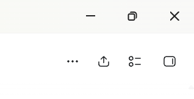
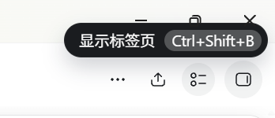
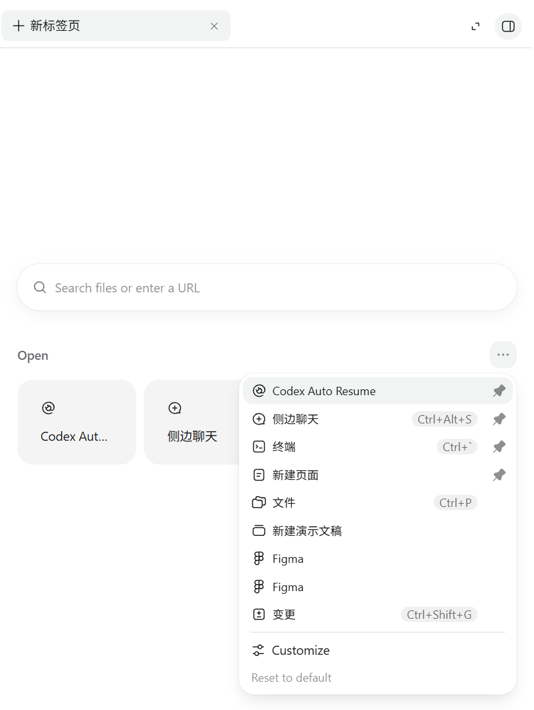
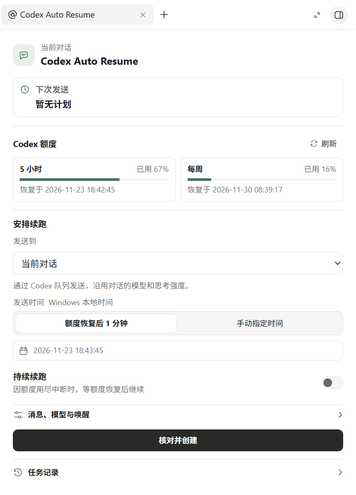

# Codex Auto Resume

[English guide](docs/README.en.md) · [下载最新版本](https://github.com/PanGucheng/CodexAutoResume-GUI/releases/latest) · [贡献指南](CONTRIBUTING.md) · [MIT 许可](LICENSE)

**在 Windows 上，等 Codex 额度恢复后自动接着跑。**

## 什么时候用得上

用 ChatGPT Plus 跑长时间的重构、迁移或测试时，5 小时额度可能在任务收尾前用完。如果额度要到凌晨才恢复，手头的工作往往就停在那里，直到你第二天回来补发下一条指令。 [Codex 额度与恢复规则](https://help.openai.com/en/articles/20001498-how-resets-work-in-codex)

在原对话侧栏选 **额度恢复后 1 分钟**，提前写好下一步，比如「跑完剩下的集成测试，修复失败项」。插件读取 **5 小时和周额度**的恢复时间，到点把这条消息交给 Codex。如果任务需要跨多个额度窗口，开启 **持续续跑**，只有 Codex 再次明确报告额度用尽时才会安排下一轮。

平时照常打开 Codex。要让原对话到点自动开跑，提前让 Codex 加载该对话，并让电脑在计划时间能够运行、Windows 用户保持登录。计划由 Windows 任务计划程序触发。Codex Auto Resume 是独立社区项目。

## 安装原生面板

1. 在 Windows 10/11 上安装并登录 Codex。确认 PowerShell 可以执行 `py -3 --version` 和 `uv --version`。需要 Python 3.10 或更高版本。安装器优先使用 Microsoft Store 版桌面自带的 `codex.exe`，其他版本需要在 `PATH` 上提供 Codex CLI。
2. 在[最新发布](https://github.com/PanGucheng/CodexAutoResume-GUI/releases/latest)下载 **Source code (zip)**，完整解压到以后会保留的位置。发布包内有构建好的面板。解压目录也是本地插件市场的来源。
3. 在解压后的项目根目录运行安装器。

   ```powershell
   powershell -NoProfile -ExecutionPolicy Bypass -File .\Install-Panel.ps1
   ```

4. 完全退出并重新打开 Codex。进入一个已保存的本机会话，点击右上角最右边的 **显示标签页**，或按 `Ctrl+Shift+B`。

   
   

5. 在右侧打开 **新标签页**。如果 **Open** 下已经有 **Codex Auto Resume** 卡片，直接点击。也可以在 **Open** 右侧点 **···**，选择 **Codex Auto Resume**，再用图钉固定入口。

   

## 当前对话续跑

保留对话原有设置时，插件默认使用官方 [`codex queue`](https://learn.chatgpt.com/docs/developer-commands#codex-queue) 底层队列。到点提交后，持有对话的 Codex 后端在可以执行时启动回合。任务记录区分 **已入队、执行中、已完成**。对话未加载或上一轮被手动中断时，消息可能继续留在 Codex 队列，打开原对话可以核对。如果 Codex 尚未开始本轮，停止持续续跑后，这条已入队的消息仍可能执行。

### 定时新建对话与高级模式

**到点新建对话**支持普通启动。新建对话或显式选择模型和思考强度时使用 App Server。如果需要在桌面仍占用原对话的情况下覆盖设置，Microsoft Store 版可用实验性的共享 App Server。从托盘退出桌面后，使用以下命令启动共享模式。

```powershell
powershell -NoProfile -ExecutionPolicy Bypass -File .\Start-SharedCodex.ps1
```

共享计划需要该本机服务持续运行。要切回普通启动，退出桌面后给上述命令加 `-StopServer`，再按原来的方式打开 Codex。服务会拒绝在发现回合正在运行时停止。

## 创建与管理计划

1. 核对面板顶部的会话标题。若需要手动绑定，粘贴 `codex://threads/<ID>` 后点击 **核对会话**。
2. 选择 **额度恢复后 1 分钟**，或输入 Windows 本地时间。两项额度均耗尽时使用较晚的恢复时间。两项都有余量时，额度快捷选项使用 5 小时窗口的恢复时间。
3. 选择 **当前对话** 或 **到点新建对话**。新对话使用当前工作目录，可在原面板的任务记录找到会话 ID。在 **消息、模型与唤醒** 里可选择账号支持的模型和思考强度。显式覆盖原对话的模型和强度会成为后续回合的默认设置。
4. 填写发送内容，按需开启 **持续续跑**，核对会话、时间和内容后确认创建。
5. 在 **任务记录** 查看发送结果、取消待执行计划，或停止后续续跑。正常结束时持续续跑随之结束。队列任务最多监控 12 小时，监控中断或到期时请先在原对话核对结果。



可以在多个对话中分别打开面板并创建计划。不同对话可以在同一时间执行，各自显示任务记录。同一对话最多有一条启用的持续续跑计划。同一账号下的会话共用额度。

工具也提供独立的 Python/Tk 窗口。双击 [Launch.cmd](Launch.cmd)，可选择本机会话并使用同一个任务库。此入口需要 Python 带 Tcl/Tk。找不到 Codex CLI 时，可在窗口的 **Codex 设置**里选择 `codex.exe`。

## 使用条件与排查

| 情况 | 处理方式 |
| --- | --- |
| 看不到原生面板 | 在已保存的本机会话里点击右上角的 **显示标签页**，再从新标签页的 **Open** 菜单查找。 |
| 到点没有发送 | 检查 Windows 用户是否仍登录，以及目标会话是否已加载。锁屏可以触发。睡眠唤醒取决于硬件和电源设置，登录后可补跑错过的计划。 |
| `already has an active writer` | 显式覆盖设置或旧计划走直连 App Server 时，另一个 Codex 进程可能仍持有会话写入锁。沿用原设置可新建队列计划。需要覆盖设置时，可用共享启动入口。 |
| 额度恢复时间不可用 | 刷新额度或手动选择首次发送时间。如果额度中断后缺少所需的恢复时间，任务记录会说明原因。 |
| 需查看日志 | 查看是否有人工交互、目标变化或登记失败。运行中的 Codex 需要批准或输入时，后台会记录该请求。 |
| 结果待核对 | 先查看原会话是否已收到消息，再决定是否新建计划。发送后断连不会自动重试。 |

后台使用当前 Windows 用户的 Codex 登录与配置。提示词和执行记录保存在 `%LOCALAPPDATA%\CodexAutoResumeGUI\jobs.sqlite3`，本机计划任务名称以 `CodexAutoResumeGUI_` 开头。后台执行器位于同一数据目录下的 `panel-runtime`。升级或移动文件夹时，保留待执行计划仍引用的运行目录。

## 源码与复用

| 入口 | 用途 |
| --- | --- |
| [`codex_client.py`](codex_client.py) | App Server 客户端、原对话消息队列、额度读取和恢复时间计算 |
| [`shared_host.py`](shared_host.py) | 本机共享后端和认证 WebSocket 转发 |
| [`jobs.py`](jobs.py)、[`task-scheduler.ps1`](task-scheduler.ps1) | SQLite 任务库、Windows 调度和续跑执行器 |
| [`panel/`](panel/) | MCP 服务、会话绑定与 TypeScript 原生面板 |
| [`plugins/codex-auto-resume/`](plugins/codex-auto-resume/) | 可安装的插件和生成的单文件面板 |
| [`tests/`](tests/) | 回归测试与可选的本机 App Server 验证 |

接口与数据流见[设计说明](DESIGN.md)，构建和测试见[贡献指南](CONTRIBUTING.md)。项目代码使用 [MIT](LICENSE)，面板内的第三方代码保留[原许可声明](THIRD_PARTY_NOTICES.txt)。
