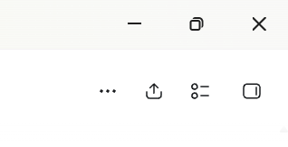
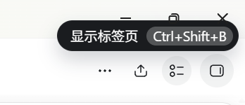
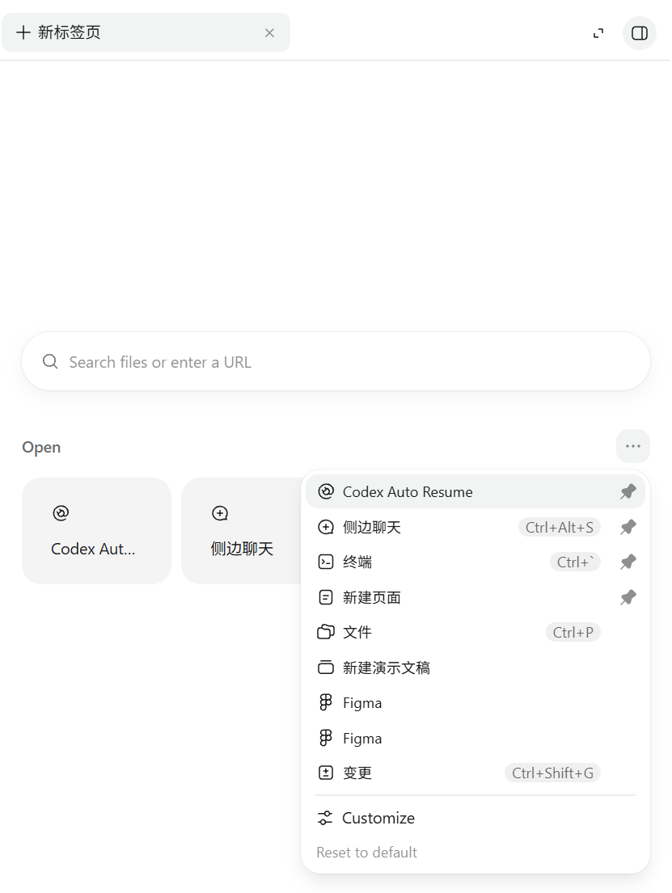
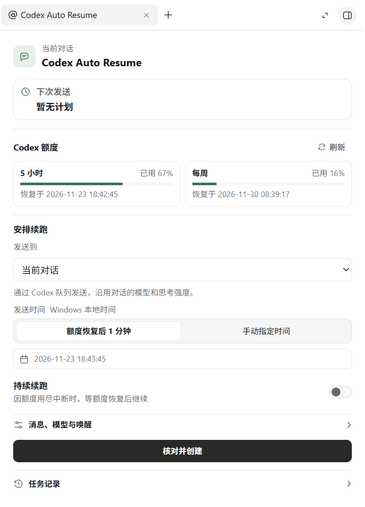

# Codex Auto Resume

[中文](../README.md) · [Latest release](https://github.com/PanGucheng/CodexAutoResume-GUI/releases/latest) · [Contributing](../CONTRIBUTING.md) · [MIT license](../LICENSE)

**Resume Codex work on Windows after your usage limit resets.**

## When to use it

A long refactor, migration, or test run can use up a ChatGPT Plus five-hour window before the work is finished. If the window resets overnight, the task can sit idle until you return and send the next instruction. [How Codex usage limits reset](https://help.openai.com/en/articles/20001498-how-resets-work-in-codex)

Open the side panel in the original chat, pick **one minute after quota reset**, and leave a follow-up such as “Run the remaining integration tests and fix the failures.” The panel reads the five-hour and weekly reset times. If the work spans multiple windows, enable continuous resume to schedule the next round whenever Codex explicitly reports quota exhaustion again.

Start Codex as usual and leave the target chat loaded for automatic dispatch. Keep your Windows user signed in and make sure the PC can run at the scheduled time. This independent community project uses Windows Task Scheduler to submit each message.

## Install the native panel

1. Sign in to Codex on Windows 10 or 11. In PowerShell, check `py -3 --version` and `uv --version`. Python 3.10 or later is required. The installer prefers the Codex binary bundled with the Microsoft Store desktop app and can use a CLI on `PATH` for other installations.
2. Download **Source code (zip)** from the [latest release](https://github.com/PanGucheng/CodexAutoResume-GUI/releases/latest) and extract the entire archive into a permanent folder. It includes the built panel. Codex registers this folder as the source for the local plugin marketplace.
3. Run the installer from the extracted project root.

   ```powershell
   powershell -NoProfile -ExecutionPolicy Bypass -File .\Install-Panel.ps1
   ```

4. Quit and reopen Codex. Open a saved local conversation and click **Show tabs** (**显示标签页**) at the far right of the header, or press `Ctrl+Shift+B`.

   
   

5. Open a **New tab** in the right pane. Select the **Codex Auto Resume** tile under **Open**, or use the **···** menu beside **Open** to open and pin it. The panel currently uses Chinese labels.

   

## Resume the current conversation

The default path uses the same queue as the documented [`codex queue`](https://learn.chatgpt.com/docs/developer-commands#codex-queue) command and inherits the conversation's model and reasoning effort. Open Codex normally. The owning backend starts the next turn when it can. The panel distinguishes queued messages, running turns, and completed turns. Unloaded conversations or turns stopped manually can leave messages pending. Check the conversation before submitting another message. Stopping future rounds leaves the current queued message under Codex's control.

### Scheduled new chats and advanced mode

Scheduled new chats work with the normal desktop launch. New chats and explicit model or reasoning overrides use App Server. To override settings for a conversation the running desktop already owns, you can use the experimental shared App Server mode with the Microsoft Store desktop package. Quit the regular desktop instance and use this launcher to open it in shared mode.

```powershell
powershell -NoProfile -ExecutionPolicy Bypass -File .\Start-SharedCodex.ps1
```

Keep the local service running for shared jobs. To return to the default desktop launch, close Desktop, run the command with `-StopServer`, and open Codex as usual.

## Schedule a message

1. Verify the conversation title. If automatic binding is unavailable, paste the link `codex://threads/<ID>` and select **核对会话** (Verify conversation).
2. Pick **额度恢复后 1 分钟** (One minute after quota reset) or enter a local Windows date and time. When both windows are exhausted, the tool waits for the later reset. If both have capacity, the preset uses the five-hour reset.
3. Choose the current chat or a new chat in the same working directory. Open **消息、模型与唤醒** to pick a model and a supported reasoning effort. An explicit override updates the settings for subsequent turns in the target chat.
4. Enter your message, choose whether to enable **持续续跑** (Continuous resume), and confirm the target, time and message. Check **任务记录** (Job history) to cancel a pending send or stop future rounds.



A normally finished round ends continuous resume. When Codex reports a usage limit, the worker reads the reset times again before scheduling the next one-time job. A saved conversation goal can stop a scheduled send if it is already complete, paused, or replaced.

Different conversations can have their own panels and schedules, and can run at the same time. Each conversation can have one enabled continuous-resume plan. Conversations under the same account share its quota.

For the standalone window, run [Launch.cmd](../Launch.cmd) with a Windows Python installation that includes Tcl/Tk. It shares the same job history as the native panel.

## Troubleshooting

- If the panel is missing, use **Show tabs** in a saved local conversation and check the **Open** menu on its new tab page.
- While Windows is locked, scheduled sends can run with your user signed in. Wake from sleep depends on the PC and its power settings.
- If an older job or a settings override reports `already has an active writer`, the desktop may still own the thread. Create a queue job to inherit the thread's settings, or use shared mode for an override.
- The worker monitors queue jobs for up to 12 hours. If monitoring ends before the turn is confirmed, inspect the original conversation for the outcome.
- If the job reports an unknown outcome, inspect the original conversation before creating another schedule. A send that disconnects after submission is left for review.
- Jobs use your local Codex sign-in and configuration. Prompts and results are stored in `%LOCALAPPDATA%\CodexAutoResumeGUI\jobs.sqlite3`. Keep versioned runtime folders that are still referenced by pending jobs.

## Reuse the code

Start with [the App Server client](../codex_client.py) for quota handling, [the scheduler and worker](../jobs.py) for job execution, or [the native panel source](../panel/) for the MCP integration. The [architecture notes](../DESIGN.md) describe how they fit together. See the [contribution guide](../CONTRIBUTING.md) for builds and tests, and the [third-party notices](../THIRD_PARTY_NOTICES.txt) for code bundled in the panel.
